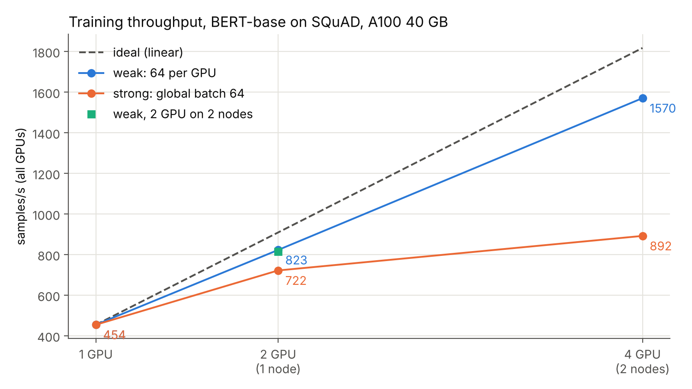
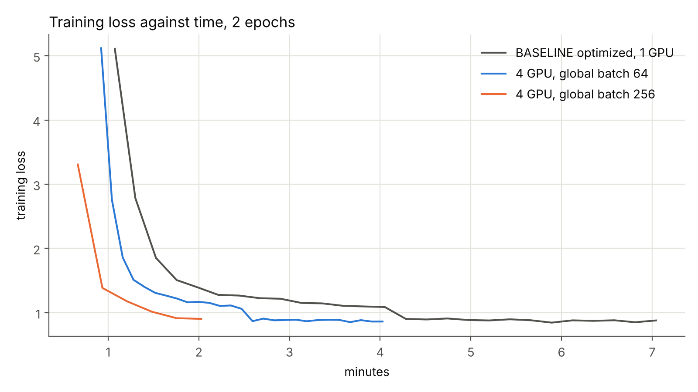

# Deliverable 2: distributed training on 2 nodes x 2 A100

The optimized training of [deliverable 1](../BASELINE/README.md) (BERT-base on SQuAD, BF16,
`torch.compile`, fused AdamW) now runs on 4 GPUs of FinisTerrae III, on 2 nodes, with PyTorch
**DistributedDataParallel (DDP)**.

**Result:** 4 GPUs process **3.46x** the samples of one GPU. Two epochs take **2.3 min instead
of 7.2**, with F1 86.62 instead of 86.97.

## 1. What was done and why

| Decision | Why |
|---|---|
| **DDP** (each GPU keeps a full copy of the model and processes a different part of the batch) | The model uses 11 of the 40 GB of an A100. It does not need to be split, so splitting it (FSDP) would only add communication |
| **Native PyTorch**, not Lightning | The training loop and the throughput measurement are those of deliverable 1, so the two deliverables can be compared directly |
| **One process per GPU, started by `srun`** | SLURM already starts the processes on both nodes; the script reads its rank from SLURM, so `torchrun` is not needed |
| **`DistributedSampler`** | Each GPU reads a different quarter of the data in every epoch |
| **DDP before `torch.compile`** | DDP sends the gradients in blocks during the backward pass, so most of the communication overlaps with the computation |
| **Everything in one 2-node job** | One wait in the queue, and every measurement runs on the same two nodes |

`train_ddp.py` reuses the data, evaluation and metrics code of `BASELINE/train_qa.py`. With
`--batch-size 64`, each GPU processes 64 samples per step.

## 2. What was measured

Throughput uses 100 steps after 60 of warmup, 3 repetitions per configuration (median shown;
the repetitions differ by less than 1 %). Speedup is relative to the same script on 1 GPU.

- **Weak scaling:** 64 samples per GPU, so the global batch grows with the GPUs.
- **Strong scaling:** global batch fixed at 64, as in deliverable 1, split among the GPUs.
- **Network:** the same 2 GPUs on one node and on two nodes.
- **Two alternatives to DDP:** ZeRO-1 (the optimizer state is split among the GPUs) and BF16
  compression of the gradients before sending them.
- **Two full trainings** of 2 epochs on 4 GPUs, with exact match (EM) and F1.

The cost to watch is the **all-reduce**: after each step the GPUs exchange and average their
gradients, 436 MB (109 M parameters x 4 bytes). That amount is the same whatever the batch.

## 3. Results



| Configuration | GPUs (nodes) | Batch per GPU | samples/s | Speedup | Efficiency |
|---|---|---|---|---|---|
| 1 GPU | 1 (1) | 64 | 454 | 1.00x | 100 % |
| Weak | 2 (1) | 64 | 823 | 1.81x | 91 % |
| Weak, through the network | 2 (2) | 64 | 815 | 1.79x | 90 % |
| **Weak** | **4 (2)** | **64** | **1570** | **3.46x** | **86 %** |
| Strong | 2 (1) | 32 | 722 | 1.59x | 79 % |
| Strong | 4 (2) | 16 | 892 | 1.96x | 49 % |
| BF16 compression | 4 (2) | 64 | 1668 | 3.67x | 92 % |
| ZeRO-1 | 4 (2) | 64 | 1284 | 2.83x | 71 % |

- **Weak scaling works (86 %).** With 64 samples per GPU, a step takes 141 ms of computation and
  the all-reduce adds only 22 ms: about half of it is hidden behind the backward pass.
- **Strong scaling does not (49 %).** With 16 samples per GPU the computation shrinks to a
  quarter, but the all-reduce does not, and it becomes 42 % of the GPU time.
- **The network is not the problem.** The same 2 GPUs are only 1 % slower on two nodes. NCCL
  uses InfiniBand at 100 Gb/s between the nodes, and inside a node the GPUs also communicate
  over PCIe (these A100 have no NVLink).
- **BF16 compression: +6 %.** It sends half the bytes. Its effect on EM and F1 was not measured.
- **ZeRO-1: -18 %.** It saves 0.65 GB per GPU, but needs an extra exchange of parameters after
  every step. It only pays off when memory is short, which is not the case here.
- **DDP on 1 GPU costs 1.3 %** compared to deliverable 1 without DDP (454 against 460 samples/s).

### Full trainings (2 epochs)



| Run | GPUs | Global batch | Time | Speedup | EM | F1 |
|---|---|---|---|---|---|---|
| Deliverable 1, optimized | 1 | 64 | 7.2 min | 1.00x | 79.13 | 86.97 |
| Same global batch | 4 | 64 | 4.1 min | 1.75x | 79.09 | 86.95 |
| **64 per GPU** | **4** | **256** | **2.3 min** | **3.16x** | **78.77** | **86.62** |

- With the **same global batch**, the model is the same as in deliverable 1 (same EM and F1):
  the distributed training is correct. But it is only 1.75x faster, for the reason above.
- With **64 per GPU**, each step processes 256 samples, there are 4 times fewer steps, and it
  is 3.2x faster. F1 drops 0.35 points. The learning rate was raised from 3e-5 to 6e-5 (x2 for a
  batch 4 times larger) and not tuned further.
- Compared to the FP32 baseline of deliverable 1 (45.8 min), two epochs are now **20x faster**.

## 4. Conclusions

- For a model that fits in one GPU, DDP is enough: 86 % efficiency on 2 nodes x 2 GPUs.
- What limits scaling is the all-reduce, whose size does not depend on the batch. It can only
  be hidden if each GPU has enough work per step (64 samples yes, 16 no).
- To really use more GPUs the global batch has to grow, and then the learning rate needs tuning.

## 5. Files and how to run

| File | Purpose |
|---|---|
| `train_ddp.py` | Distributed training script |
| `run_scaling.sh` | SLURM job (2 nodes x 2 A100): all throughput measurements, ~25 min |
| `run_full.sh` | SLURM job (2 nodes x 2 A100): the two full trainings, ~10 min |
| `summarize.py`, `plots.py` | Results table and figures |
| `results/`, `profiles/`, `figures/` | One JSON per run, profiler traces, figures |

```bash
cd DISTRIBUTED && mkdir -p logs
sbatch run_scaling.sh; sbatch run_full.sh
python summarize.py results; python plots.py results
```

Each job requests 2 nodes with 2 A100 and 2 x 32 cores per node (FT3 requires 32 cores per
A100) and 128 GB per node. The data and model are those prepared for deliverable 1 in `$STORE`.
Both jobs ran at the first attempt, on nodes `c208-8` and `c209-7`, with PyTorch 2.11 and NCCL
2.28.
